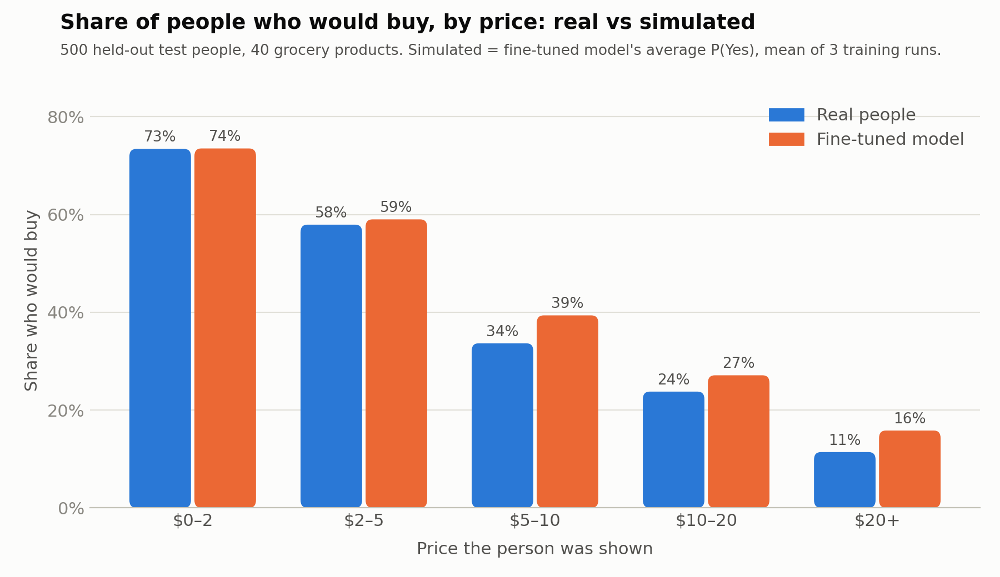

# Can a small fine-tuned model predict who buys at what price?

A pre-registered experiment in simulating real people's purchase decisions with a small language model,
fine-tuned with LoRA on a laptop (MacBook Pro M5, 24 GB).

**Short answer:** fine-tuning took the model from 45% to 72% accuracy, and it really does use who the person is,
but on individual Yes/No decisions it did **not** beat a simple price-only rule (72.0% vs 73.1%, over 3 runs).
At the group level, its predicted share of buyers lands within 0.1–5.7 points of reality at every price level.



---

## Results at a glance

| Question | Answer |
|---|---|
| Does fine-tuning help? | **Yes, a lot.** Untrained 45.4% → fine-tuned 72.0% |
| Does it beat the simple price rule (73.07%)? | **No.** 72.04% on average, 1.0 point below (95% range −1.5 to −0.6) |
| Does it use who the person is? | **Yes, but only a little.** +0.78 points over a stranger's description (95% range +0.4 to +1.2) |
| How close to the human limit? | 85.2% of the human test-retest ceiling |
| Group-level share of buyers | Within 0.1–5.7 points at every price band |

Both success rules were written down and committed to GitHub **before** any model was run
(see [PREREGISTRATION.md](PREREGISTRATION.md) and the first commit, 20 Nov 2026).
Rule 1 (beat the price rule): **failed**. Rule 2 (real description beats a stranger's): **passed**.

---

## The question

Each of 2,058 real US adults was shown 40 grocery products, each at a **randomly assigned price**, and asked:

> *"Land O Lakes Salted Stick Butter, 16 oz. The product is priced at: $8.45. Would you or would you not purchase this product?"*

Two weeks later, they answered the same 40 questions again.

**Can a model that knows a few facts about a person predict that person's Yes or No?**

## Data

[Twin-2K-500](https://huggingface.co/datasets/LLM-Digital-Twin/Twin-2K-500) (Toubia et al., 2025, *Marketing Science*; CC-BY-4.0):
2,058 people, about 500 questions each, four survey waves. The 40 pricing questions were asked in waves 1–3 and repeated in wave 4.

- **Target:** each person's real wave 4 answer (Yes/No) to each of the 40 products.
- **Prices are randomized per person** (≈345 distinct prices per product), so this is a real price experiment:
  for butter, 93% would buy at $0, 68% at $4.22 and 18% at $10.56.

## Design

**Split (fixed, `random_state=42`):** 500 test people (20,000 answers) never seen in training;
1,458 training people; 100 validation people (training people held out to watch for overfitting).

**Reference points (no AI):**

| Predictor | Accuracy on test |
|---|---|
| Human ceiling: same person, same question, two weeks earlier | 84.55% |
| Price rule: for this product at this price band, did most training people buy? | **73.07%** (the bar to beat) |
| Always "No" | 56.29% |

**Person description (decided before training):** demographics that plausibly affect grocery buying
(region, gender, age, education, employment, marital status, income, household size) and 11 money/decision scores as percentiles
(tightwad–spendthrift, financial literacy, numeracy, risk aversion, loss aversion, impatience, present bias,
mental accounting, minimalism, maximization, conscientiousness).
Race, religion, political views and citizenship were **left out on purpose**: they have little to do with buying butter
and invite the model to stereotype. The description never contains any purchase answers.

**Stranger control:** the same model, but each test person gets *another* test person's description.
If the real description doesn't beat the stranger's, the model isn't using who the person is.

## Model and training

| Setting | Value | Why |
|---|---|---|
| Base model | Qwen3-4B-Instruct-2507, 4-bit ([mlx-community](https://huggingface.co/mlx-community/Qwen3-4B-Instruct-2507-4bit)) | Small enough to fine-tune on a laptop |
| Framework | Apple MLX (`mlx-lm` 0.32.2) | Runs on the Mac's GPU |
| Method | **LoRA**, rank 8, 16 layers; 7.3M of 4,022M parameters trained (0.18%) | Full fine-tuning doesn't fit on a laptop; LoRA trains a small add-on and leaves the base model frozen |
| Learning rate | 1e-4 | Chosen by experiment (below) |
| Batch size / iterations | 8 / 2,000 (16,000 practice questions) | About 2.5 h per run |
| Loss | `--mask-prompt`: only the answer is graded | The model should learn the decision, not repeat the description |
| Runs | 3, seeds 0, 1, 2 | Training is random; one run can mislead |

**How the model answers:** for each question, I read the model's probability of "Yes" vs "No" (no text generation).
"Yes" if the probability is above 50%. The group-level shares use the probabilities directly.

**Learning-rate experiment (300 iterations, 50 test people):**
`1e-5` scored 60.6% and said "No" to almost everything above $2; `1e-4` scored 67.4% and followed price.
I picked `1e-4` for the main runs.

## Results

| | Run 1 (seed 0) | Run 2 (seed 1) | Run 3 (seed 2) | **Average** |
|---|---|---|---|---|
| Accuracy, real description | 73.38% | 69.40% | 73.35% | **72.04%** |
| Accuracy, stranger's description | 72.36% | 68.83% | 72.58% | **71.26%** |
| Model says "Yes" (real: 43.7%) | 40.4% | 57.5% | 36.2% | |
| vs price rule (73.07%) | +0.31 | −3.67 | +0.28 | **−1.03** |
| Real − stranger | +1.02 | +0.56 | +0.77 | **+0.78** |

For comparison, the **untrained** model scored 45.37% (stranger: 45.07%) and said "Yes" 93.8% of the time,
regardless of price: 95% Yes at $0–2 and 91% Yes at $20+.

**Is a difference real or luck?** I re-sampled the 500 test people with replacement 2,000 times (bootstrap) and recalculated each difference:

- Average vs price rule: **−1.03 points, 95% range −1.49 to −0.57**, below zero, so the model really is slightly worse than the rule.
- Average real − stranger: **+0.78 points, 95% range +0.40 to +1.17**, above zero, so the persona effect is real.

**Group level (average probability of Yes, mean of 3 runs):**

| Price band | Real share who buy | Model | Points out |
|---|---|---|---|
| $0–2 | 73.4% | 73.5% | 0.1 |
| $2–5 | 57.9% | 59.0% | 1.1 |
| $5–10 | 33.7% | 39.4% | 5.7 |
| $10–20 | 23.8% | 27.1% | 3.3 |
| $20+ | 11.4% | 15.8% | 4.4 |

## What I learned

1. **One run can fool you.** Run 1 alone "beat" the price rule; the average of 3 did not. Run 2 was trained identically
   except for the shuffle order, yet said "Yes" 58% of the time and lost 4 points.
2. **Loss is not the goal.** The first test run's validation loss fell from 13.3 to 0.29 while the model still said "Yes"
   to almost everything: it had learned the easy end-of-message token, not the decision. Runs 2 and 3 had almost the same
   validation loss (0.242 vs 0.235) but accuracies 4 points apart. Only the held-out accuracy tells you what you care about.
3. **The persona effect is real but small.** Price alone gets ~73%; the human ceiling is ~85%. Of that ~11.5-point room
   for "knowing the person", the model captured under 1 point.
4. **Individual vs group.** Rounding each person to Yes/No throws away the model's uncertainty. Averaged probabilities
   predict the share of buyers much better than individual answers predict each person.

## Why it didn't beat the price rule (my best guesses)

- **Price judgement:** the rule knows each product's price cut-off exactly; the model must infer from text whether $8.45 is cheap
  *for butter*, which language models are weak at.
- **Weak personal signal:** psychology scores say little about grocery buying, and the description has no purchase behaviour.
- **Fragile threshold:** many answers sit near 50%, so a small shift (run 2) flips thousands of decisions.

## Deviations and limitations

- **Description source:** PREREGISTRATION.md says the persona comes from waves 1–3 answers. I built it from the dataset's
  ready-made `persona_summary`, which summarises the full survey. I checked that none of the chosen fields come from the
  questions repeated in wave 4, and the summary contains no purchase answers.
- **Missing scores:** loss aversion exists for only 32% of people in the data (risk aversion missing for 11%, impatience for 9%);
  those lines are simply absent from the description.
- **Price rule bands** are quintiles of all shown prices per product (prices only, never answers).
- **Run 1 validation losses** were printed but not saved; runs 2–3 logs are in `logs/`. In runs 2 and 3 the validation
  loss flattened at ≈0.24 after 250 iterations, with no sign of overfitting.
- **One small model** (4B, 4-bit), one dataset, one task (grocery products in a survey, not real purchases).
- **Test set use:** the 500 test people decided this result. Any follow-up experiment must be chosen on the validation
  people and tested on the test people only once.

## Next: version 2

Add **purchase history** to each description: show the model a person's first-round answers for 20 products and predict
the other 20. The best predictor of what someone buys is what they bought before. This will get a new pre-registration first.

## Reproduce

```bash
python3.12 -m venv .venv && source .venv/bin/activate
pip install mlx-lm datasets pandas matplotlib

python get_data.py                 # download Twin-2K-500 into data/
python build_pricing_table.py      # 2,058 people × 40 products
python split_and_baselines.py      # test split, human ceiling, price rule
python run_base_model.py           # untrained model (add --stranger for the control)
python build_training_data.py      # short descriptions + training/validation files

mlx_lm.lora --model mlx-community/Qwen3-4B-Instruct-2507-4bit --train --data data/training \
  --iters 2000 --batch-size 8 --mask-prompt --learning-rate 1e-4 \
  --steps-per-report 50 --steps-per-eval 250 --val-batches 25 --save-every 250 \
  --adapter-path adapters/main_run
python run_finetuned_model.py --adapter adapters/main_run              # score on 500 test people
python run_finetuned_model.py --adapter adapters/main_run --stranger   # control
bash run_two_more_runs.sh          # runs 2 and 3 (seeds 1, 2)
python make_chart.py               # the chart above
```

## Method inspiration

The evaluation rules follow the ones described in Talp's public Lab papers,
[*Accurate at What?*](https://talp.ai/assets/pubs/accurate-at-what.pdf) and
[*The Benchmark Defines the Claim*](https://talp.ai/assets/pubs/benchmark-defines-the-claim.pdf):
write the prediction rules down first, never show the model the answer, always race a simple baseline,
and run the same test more than once.

---

*Said Rustamov | November 2026*
